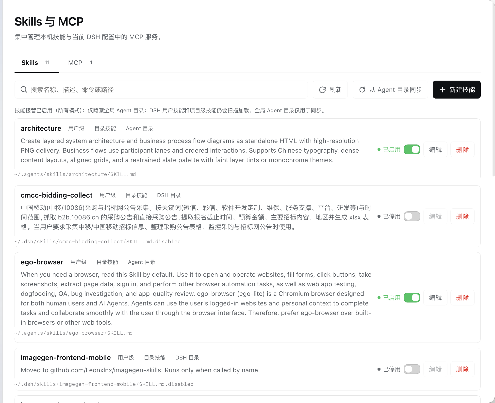
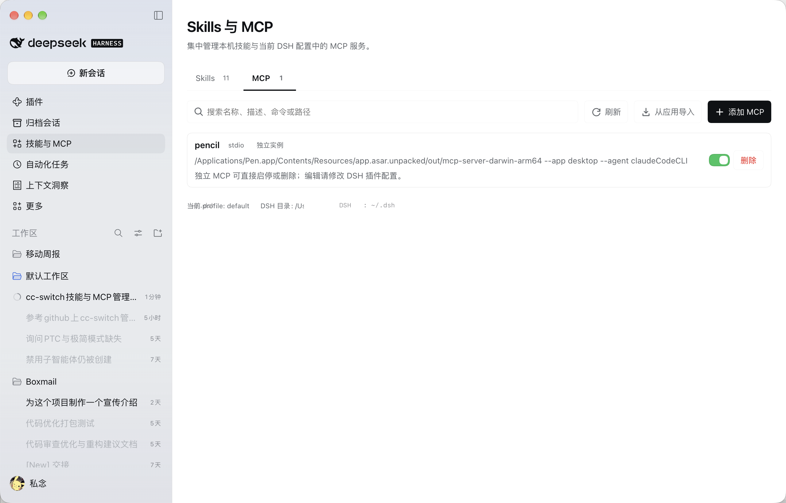

<p align="right"><a href="README.md">中文</a> | English</p>

# DSH Skills and MCP Manager

A DSH sidebar plugin for managing local Skills and MCP servers. The interface uses DSH theme tokens, does not embed an iframe, and keeps the fixed entry `Skills & MCP`.

The plugin takes over DSH skill discovery at the Host layer, so `~/.agents/skills` is not loaded into the model catalog by default. Only skills you explicitly synchronize enter DSH, keeping the skill list small and predictable.



## Takeover of DSH skill loading

DSH normally treats the global Agent directory as a skill source. The plugin takes over `list`, `snapshot`, and `get` on the `ctx.skills` service:

- The global `~/.agents/skills` directory never enters the model skill catalog.
- Global Agent skills are not loaded passively in conversations.
- Agent source files are never deleted, moved, or modified.
- The global Agent directory appears only in the sync preview.

Synchronization is explicit:

1. Open **Sync from Agent directory**.
2. Choose symlink or copy mode.
3. Select the skills to synchronize.
4. Confirm to copy only the selected skills into `~/.dsh/skills`.

DSH therefore sees only the skills you choose, not everything present in `~/.agents/skills`.

Takeover applies to every Agent mode, including PTC, standard, minimal, and cordis.

### Sources that still load normally

These sources continue to be scanned and loaded:

- User-level `~/.dsh/skills`
- Project-level `$WORKSPACE/.dsh/skills`
- Project-level `$WORKSPACE/.agents/skills`
- Built-in DSH skills
- Other `custom` and `runtime` sources

Only the global `~/.agents/skills` directory is excluded. A project-level `.agents/skills` directory belongs to its workspace and still participates in that workspace's load.

### Benefits

- A shorter skill catalog with less unrelated content in context.
- Experimental or temporary Agent skills are not triggered automatically.
- Skills can be synchronized on demand and removed at any time without touching Agent originals.
- Copy mode provides an isolated copy whose edits and deletions never write back to the source.

## Features

### Skills

- Search, create, edit, enable, disable, and delete user-level and project-level skills.
- Create a skill at user or project scope. Project scope can use an existing workspace or create and register a new workspace from a name and parent directory.
- Project skills are written to `.agents/skills` in the selected workspace.
- The main list shows user skills, the current workspace, and project skills from every registered workspace. The global Agent source appears only in the sync preview.
- `.agents` project skills in other registered workspaces can also be edited, toggled, and deleted; the info icon beside the title explains the impact.
- User and current-workspace skills are deduplicated by name. Same-named skills in different workspaces remain separate and carry a workspace badge.
- Deleting a locally created real skill moves it to the DSH trash directory.
- Synchronize from `~/.agents/skills` into `~/.dsh/skills`; symlink mode is the default, and copy mode is optional.
- Symlink mode copies no files; changes in the Agent source are immediately reflected in DSH.
- Copy mode creates an independent copy. Edits and deletions do not modify the Agent source, and updates recreate the copy.
- Preview every sync item before applying, choosing the mode and the skills to process.
- Correct existing targets are skipped. Different links, real directories, or stale copies are backed up before replacement.
- Deleting a symlinked skill removes only the DSH link. Deleting a copied skill removes only the DSH copy.
- Synced skills show a `Symlink` or `Copy` badge in the list.
- Batch selection and deletion report per-item success and failure. Symlinked skills remove only the DSH link.
- Create a skill by dragging or choosing a `.zip` skill package; `SKILL.md` and companion files are imported together.

### Project skills

Project skills are scanned from the current session workspace, not from a DSH profile directory:

```text
$WORKSPACE/.dsh/skills
$WORKSPACE/.agents/skills
```

`$WORKSPACE` is the workspace bound to the current session. For a session opened in `/Users/<user>/Documents/Personal`, the plugin reads:

```text
/Users/<user>/Documents/Personal/.dsh/skills
/Users/<user>/Documents/Personal/.agents/skills
```

DSH's filesystem skill provider loads project skills. The plugin displays and manages them without copying files.

Names such as `default` and `desktop` are DSH profiles. They determine where plugin and MCP configuration lives, not the project skill directories. The Skills footer shows the user skill directory; the MCP tab does not show directory details.

Project skills support creation, editing, toggling, and deletion. When creating one, bind an existing workspace or create and register a new workspace. New workspaces default to `~/Documents`, and the parent directory can be changed in the dialog.

Before an Agent tool creates and registers a workspace, it checks the target against the current session file policy: `danger-full-access` creates directly; `workspace-write` creates directly inside the session workspace or one of its extra writable roots; for `read-only`, out-of-range targets, or an unresolvable policy, the plugin requests Host approval and does not create or register anything without it. Paths are compared by real path, and symlink escapes are treated as out of range. Direct user actions in the panel do not ask twice.

`.agents` project skills in every registered workspace are scanned and displayed with editing, toggling, and deletion. For cross-workspace actions, the info icon, edit dialog, and delete confirmation explain the affected workspace, what future sessions will read, and that running sessions may need to reload.

Project `.dsh/skills` is managed by DSH and shown read-only. The global `~/.agents/skills` directory is read-only; editing a symlinked synced skill writes back to its Agent source. Copy mode changes only the local DSH copy and uses fingerprints to detect source changes and local edits.

### MCP

- Add, edit, enable, disable, delete, test, and reconnect MCP servers.
- Manage MCP Manager entries and show standalone `@deepseek-ai/dsh-mcp-client` instances mounted directly in the profile.
- Standalone instances support editing connection parameters, toggling, and deletion. Before deletion the profile patch is backed up, then the matching configuration row is removed.
- Transports include `stdio` and `SSE / Streamable HTTP`. SSE configuration is carried by DSH's Streamable HTTP transport.
- Edit with a form or JSON. JSON accepts an `mcpServers` wrapper or a single server configuration; creating from JSON can save multiple servers at once, while editing accepts one.
- Multi-server JSON creation validates every entry and completes approval before a single write, so a failure leaves no partial configuration.
- `type: "sse"` or `transport: "sse"` in JSON maps to DSH's `streamable-http`.
- Import user-level MCP configuration from Claude Code, Codex, Gemini CLI, OpenCode, and Cursor.
- Preview entries and their sources before import. Entries are unchecked by default and imported disabled by default.
- If the source changes after preview, the import is rejected so commands are not run without confirmation.
- Same-named existing entries are skipped. Same-named entries with different configuration are shown separately by source.
- The Agent tool asks for Host approval before saving and starting, enabling, restarting, testing, or importing and enabling a stdio MCP.
- If approval is rejected, cancelled, unavailable, or the current session has no approval prompt, the operation fails without writing configuration or starting a process.
- Enable, restart, and connection test re-check the stdio configuration after approval and refuse if the command changed. Save and import write the configuration that was approved.
- Approval is requested only when an operation would really start a local stdio command. HTTP MCPs, disable, delete, and imports that stay disabled do not ask.
- Testing or restarting a plugin-registered MCP also asks for approval, because its transport cannot be read and it may start a local command.
- Panel actions are initiated by you directly and do not ask again.

DSH's default `danger-full-access` permission preset sets approval to `never`; Agent operations above are then rejected. Switch to a preset that allows approval, or use the panel directly.



## Languages

The plugin UI follows **DSH Settings → General → Language** and supports the same eight languages DSH currently offers:

- 中文 (zh)
- English (en)
- 日本語 (ja)
- Español (es)
- Français (fr)
- Deutsch (de)
- Русский (ru)
- Português (pt)

The plugin interface changes automatically when DSH's language changes. Skill and MCP list content is **not translated**; names, descriptions, file contents, commands, and URLs are shown in their original language.

Plugin metadata is localized for all eight languages. READMEs are available in all eight languages; release notes are available in Chinese and English, and the full reference documentation remains available in Chinese and English.

## Installation

The current version targets and is verified on DSH `0.2.3-alpha.2`. Other DSH versions may change service interfaces.

Install from npm with automatic updates:

```bash
dsh plugin --profile desktop add dsh-capability-switch
```

Install from source (local directory installs do not auto-update):

```bash
git clone https://github.com/lock-down/dsh-capability-switch.git
cd dsh-capability-switch
npm install --ignore-scripts
```

In DSH, open **Plugins**, choose **Add plugin**, and select this directory. After installation, `Skills & MCP` appears in the left sidebar.

You can also download `dsh-capability-switch-1.6.2.tgz` from a GitHub Release and install it as a directory.

Install a pinned GitHub version (Git installs do not auto-update):

```bash
dsh plugin --profile desktop add "git+https://github.com/lock-down/dsh-capability-switch.git#v1.6.2"
```

## Auto update

npm installations check for and update to compatible stable releases:

- Check about 45 seconds after startup, then every 6 hours.
- Only the npm registry installation of `dsh-capability-switch` updates itself.
- Local directory links and pinned Git installs never replace themselves.
- Only `bundle: true`, non-deprecated, non-prerelease, DSH-compatible versions are selected.
- Updates use DSH's `pluginManager.updateBundle`.
- With HMR the new version loads automatically; otherwise DSH asks for a restart.
- Auto update never changes Skills, MCP, workspaces, or sync state.

The header shows the current version, the auto-update switch, **Release notes**, and **Check for updates**. When an update is available, the status bar shows the latest and current versions and an **Update to this version** button. With no update available, a manual check reports **You are on the latest version** and the current version. Checking updates changes only the update state and never reloads or disables the Skills or MCP list. Turning auto update off still allows manual checks and installs. The preference is stored in `~/.dsh/capability-switch/update-preferences.json`.

**Release notes** reads this repository's GitHub Releases and shows the latest release name, version, publication date, notes, and collapsible earlier releases. The current version prefers the packaged Chinese or English note under `docs/releases`; older releases fall back to the GitHub body. Results are cached for 10 minutes and can be refreshed manually; failures show an error and a retry action.

`1.5.0` is the first version with auto update. Versions `1.4.9` and older need one manual install of `1.5.0` before later versions can update automatically.

Update checks read version lists from the npm registry; release notes read the GitHub Releases API. Neither uploads local Skills, MCP configuration, or credentials.

## Usage

### Synchronize Skills

1. Open the Skills tab of `Skills & MCP`.
2. Select **Sync from Agent directory**.
3. Choose a sync mode:
   - **Symlink mode**: Windows requires Developer Mode.
   - **Copy mode**: uses more space and recreates copies on updates.
4. Review sources, targets, the backup directory, and the change list.
5. Select the skills to sync and confirm.

Symlink mode creates DSH symlinks pointing to the Agent source. Changes in the Agent directory appear in DSH immediately, and editing a synced skill writes back through the link.

Copy mode copies skill directories or files into DSH and creates independent copies. Editing or deleting affects only the DSH copy; Agent source files stay unchanged, at the cost of extra disk space.

Copy sync records baseline fingerprints for the source and copy. On the next sync:

- Only the source changed: mark **Update copy**.
- Only the DSH copy changed: mark **Locally modified**, unchecked by default.
- Both changed: mark **Both changed**, unchecked by default.
- Content matches the baseline: skip.

A local copy is backed up before being overwritten.

If DSH already has a real directory or different content at the target, the plugin moves it to `~/.dsh/capability-switch/skill-sync-backups` before installing the chosen mode.

### Batch delete Skills

1. In the Skills tab, select skills to delete. Use **Select all** first, optionally after filtering by search.
2. Choose **Delete selected** and confirm the list and count.
3. Deletion runs per item and reports successes and failure reasons.

A symlinked skill removes only the DSH link and keeps the Agent source directory. Local, copied, and real-directory skills move to `~/.dsh/capability-switch/trash`.

### Import a ZIP skill package

1. Select **New skill**, then drop a `.zip` into the dialog or click the package area to choose a file.
2. The preview shows the package name, description, and file list. A ZIP package is imported from its own `SKILL.md`.
3. Choose user or project scope and the target workspace, then select **Import package**.

Limits: the archive may be at most 8 MiB; extracted content at most 20 MiB and 200 files; a single file at most 2 MiB; `SKILL.md` at most 1 MiB. Absolute paths and directory traversal are rejected. `SKILL.md` may be at the archive root or inside one top-level directory.

### View release notes

1. Select **Release notes** in the header.
2. Read the latest release notes and publication date.
3. Expand **Earlier releases** for older notes, or open GitHub for the full page.

### Import MCP

1. Switch to the MCP tab and select **Import from apps**.
2. Choose the entries to read.
3. Optionally enable **Enable immediately after import**. Imports stay disabled by default, so a stdio MCP does not start a local command.
4. Select **Import selected**.

Imports only read user-level configuration from other apps and never rewrite the source files.

## Data and permissions

The plugin accesses local files and fixed public network endpoints only:

- `~/.dsh/skills`
- `~/.agents/skills`
- `~/.dsh/capability-switch/backups`
- `~/.dsh/capability-switch/trash`
- `~/.dsh/capability-switch/skill-sync-backups`
- `~/.dsh/capability-switch/skill-sync-state.json`
- `~/.dsh/capability-switch/update-preferences.json`
- The active DSH profile's `cordis.patch.yml`

Before deleting a standalone MCP, the profile patch is backed up to `~/.dsh/capability-switch/backups`.

Network access is limited to the npm registry (auto update) and this repository's Releases on `api.github.com` (release notes). The plugin does not upload Skills, MCP configuration, or credentials; MCP connections are handled by DSH's MCP Manager and the corresponding MCP service.

## Development

```bash
npm install --ignore-scripts
npm test
npm pack
```

On Windows, a PowerShell entry point finds Node from `-NodePath`, `node` on PATH, common installation directories, Node under `~/.dsh/dsh-runtimes`, or `DSH_NODE_EXECUTABLE`; it sets `ELECTRON_RUN_AS_NODE=1` for Electron when needed:

```powershell
pwsh -File test/run-windows.ps1
# or
npm run test:windows
```

An explicit Node can also be supplied:

```powershell
pwsh -File test/run-windows.ps1 -NodePath 'C:\Program Files\nodejs\node.exe'
```

The entry point times out after 300 seconds by default; use `-TimeoutSeconds` to change it.

Regression coverage includes:

- Creating, editing, enabling, disabling, deleting, and symlink-syncing skills
- Skill path validation (multi-level symlink escapes) and cross-volume delete fallback
- Copy sync, unchanged skips, update replication, and copy deletion
- Same-name deduplication and skill-source takeover
- Excluding the global Agent directory and not loading the session directory wholesale
- Project, user, built-in, and global Agent sources
- Scanning project skills in every registered workspace and cross-workspace editing
- Registered-workspace authorization and rejection of unregistered paths
- Workspace creation policy checks, out-of-range approval, read-only/no-policy/no-approval/no-Agent fail-closed behavior, symlink escapes, and direct panel creation
- MCP import preview, conflict handling, and disabled-by-default behavior
- Standalone MCP editing, read-only permissions, toggling, patch deletion, and backups
- Host approval for MCP start operations, rejection before writes, changed configuration during approval, missing approval context, and no prompts for HTTP or disabled operations
- Approval for connection tests and restarts of plugin-registered MCPs
- Whole-batch validation and a single write for batch MCP save
- Reserved names rejected for MCP and backend errors shown by panel connection tests
- Install source, candidate version, and return-value checks before applying updates
- SSE mapping, form editing, and JSON editing
- Sync mode detection (symlink/copy) and copy baseline matching
- Batch skill deletion success, failure, and partial completion
- ZIP package parsing, companion file import, directory traversal rejection, and multiple `SKILL.md` rejection
- Release notes caching, link validation, and request failure
- Host routes, ZIP and batch-delete routes, agent tool and lossless JSON output
- Required panel route auth declarations, cold-session observation lease release, and DSH 0.2.3 compatibility checks
- npm registry update checks, stable version filtering, no-update state, and rejection of auto update for local installs
- Update operations isolated from Skills/MCP list state and busy states
- UI locale dictionaries for all eight DSH languages with matching keys and placeholders

Main files:

- `lib/index.js`: Host entry, HTTP routes, and the `capability_manager` tool
- `lib/client.js`: sidebar interface, UI locale dictionaries, and locale-change subscription
- `lib/skills.js`: Skills management, sync, batch deletion, and ZIP import
- `lib/zip.js`: secure ZIP skill package parsing
- `lib/releases.js`: GitHub Release notes reading and caching
- `lib/mcp.js`: MCP management and standalone instance operations
- `lib/update.js`: npm auto-update checks, downloads, and DSH plugin manager updates
- `lib/imports.js`: MCP configuration readers for other apps
- `locale/*.json`: eight-language plugin metadata
- `docs/releases`: localized copies of the current release notes

## License

[MIT](LICENSE)
