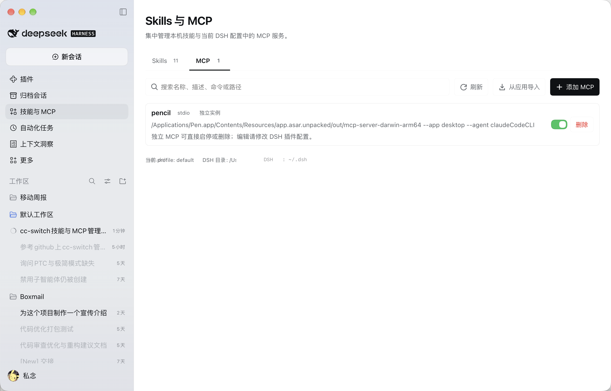

# DSH 技能与 MCP 管理

一个 DSH 侧边栏插件，用来管理本机的 Skills 和 MCP。界面使用 DSH 主题令牌，不嵌入 iframe，入口固定为 `技能与MCP`。


## 功能

### Skills

- 搜索、新建、编辑、启停和删除用户级技能。
- 列表按技能名去重，同名时优先显示 DSH 目录中的条目。
- 删除本地新建的真实技能时移入回收目录。
- 从 `~/.agents/skills` 同步到 `~/.dsh/skills` 时创建软链接，不复制文件。
- 同步前逐项预览，可选择要处理的技能。
- 已有正确软链接会跳过；不同链接或真实目录会先备份，再替换为软链接。
- 删除同步技能时只移除 DSH 软链接，Agent 源文件保留。
- 编辑同步技能会通过软链接写入 Agent 源文件，修改前保留备份。

### 技能接管

插件在 Host 层隐藏全局 `~/.agents/skills`，对 PTC、standard、minimal、cordis 等所有 Agent 模式生效。

以下来源继续正常扫描和加载：

- 用户级 `~/.dsh/skills`
- 项目级 `.dsh/skills`
- 项目级 `.agents/skills`
- DSH 内置技能
- 其他 `custom` 和 `runtime` 来源

全局 Agent 目录只作为同步来源，不出现在模型技能目录中。

### MCP

- 新增、编辑、启停、删除、连接测试和重新连接。
- 管理 MCP Manager 中的配置，也能显示直接挂载的独立 `@deepseek-ai/dsh-mcp-client` 实例。
- 独立实例可直接启停和删除。删除前会备份 profile 补丁，再移除对应配置行。
- 从 Claude Code、Codex、Gemini CLI、OpenCode 和 Cursor 导入用户级 MCP 配置。
- 导入前显示预览和来源。默认不勾选，默认导入为停用。
- 预览后来源变化会拒绝导入，避免执行未经确认的命令。
- 同名现有条目会跳过；同名但配置不同时按来源分开显示。



## 安装

当前版本针对 DSH `0.2.2-rc.3` 开发和验证。DSH 的其他版本可能调整服务接口。

从源码安装：

```bash
git clone https://github.com/lock-down/dsh-capability-switch.git
cd dsh-capability-switch
npm install --ignore-scripts
```

在 DSH 中打开“插件”，选择“添加插件”，然后选择这个目录。安装完成后，左侧边栏会出现 `技能与MCP`。

也可以下载 GitHub Release 中的 `dsh-capability-switch-1.2.0.tgz`，解压后按上面的目录方式安装。

## 使用

### 同步 Skills

1. 打开 `技能与MCP` 的 Skills 标签。
2. 点击“从 Agent 目录同步”。
3. 检查来源、目标、备份目录和变更列表。
4. 勾选要同步的技能，然后点击“确认同步”。

构建出的 DSH 条目是指向 Agent 来源的软链接。Agent 中的内容变化会直接反映到 DSH，不需要再次同步。

同步前如果 DSH 中已有真实目录，插件会把它移到 `~/.dsh/capability-switch/skill-sync-backups`，再创建软链接。

### 导入 MCP

1. 切到 MCP 标签，点击“从应用导入”。
2. 选择要读取的条目。
3. 按需要勾选“导入后立即启用”。默认导入为停用，stdio MCP 不会启动本机命令。
4. 点击“导入选中项”。

导入只读取其他应用的用户级配置，不改写来源文件。

## 数据与权限

插件只访问本机文件：

- `~/.dsh/skills`
- `~/.agents/skills`
- `~/.dsh/capability-switch/backups`
- `~/.dsh/capability-switch/trash`
- `~/.dsh/capability-switch/skill-sync-backups`
- 当前 DSH profile 的 `cordis.patch.yml`

删除独立 MCP 前，原 profile 补丁会备份到 `~/.dsh/capability-switch/backups`。

插件不上传技能、MCP 配置或凭据。MCP 连接由 DSH 的 MCP Manager 和对应 MCP 服务处理。

## 开发

```bash
npm install --ignore-scripts
npm test
npm pack
```

回归测试覆盖：

- Skills 新建、编辑、启停、删除和软链接同步
- 同名技能去重与技能来源接管
- 项目级、用户级、内置和全局 Agent 来源
- MCP 导入预览、冲突处理和默认停用
- 独立 MCP 启停、补丁删除和备份
- Host 路由、代理工具和无损 JSON 输出

主要文件：

- `lib/index.js`：Host 入口、HTTP 路由和 `capability_manager` 工具
- `lib/client.js`：侧边栏界面
- `lib/skills.js`：Skills 管理和同步
- `lib/mcp.js`：MCP 管理和独立实例操作
- `lib/imports.js`：其他应用的 MCP 配置读取

## 许可证

[MIT](LICENSE)
